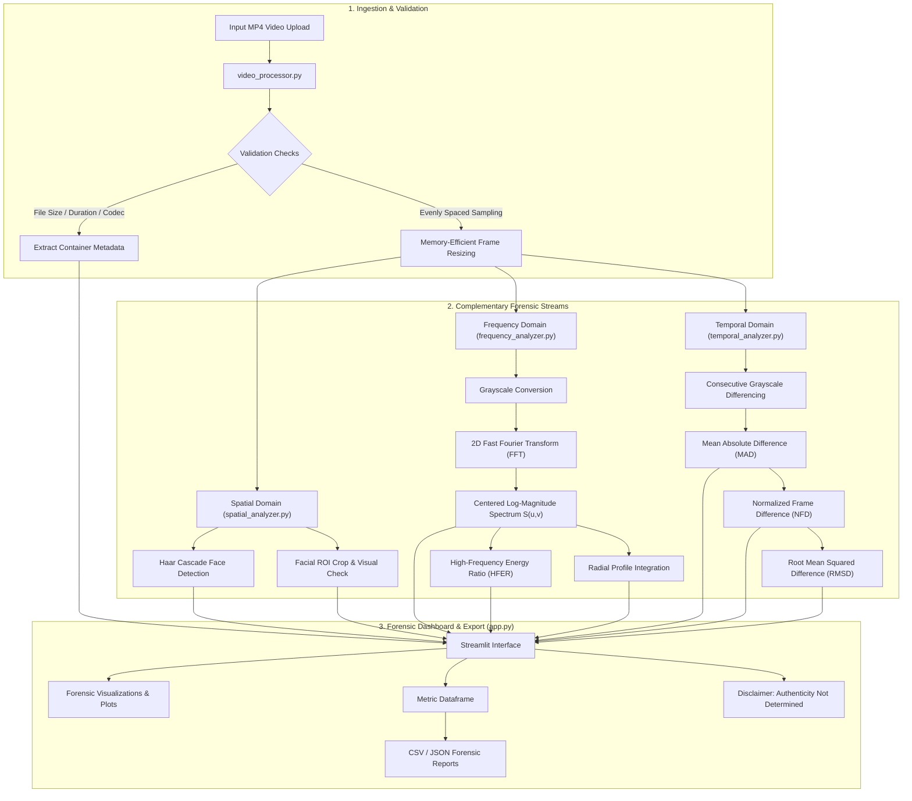

# Cross-Domain Spatial-Frequency Interaction and Temporal Consistency Network for Robust Deepfake Video Detection

**B.Tech Capstone Project-I: Forensic Prototype & Exploratory Framework**

---

> [!WARNING]
> **Academic & Forensic Integrity Notice:**
> This repository contains an **exploratory, rule-based forensic prototype** designed for Capstone Project-I.
> It extracts and visualizes spatial features, 2D Fast Fourier Transform (FFT) frequency spectra, and inter-frame temporal continuity metrics.
> **No neural network has been trained or deployed yet.** The system explicitly outputs:
> `“Experimental forensic analysis — authenticity not determined”`
> High or low metrics reflect video dynamics, compression, or lighting and cannot be interpreted as proof of real or fake media.

---

## 1. System Architecture



---

## 2. Module-by-Module Explanation

| Module | Primary Responsibility | Key Mathematical & Algorithmic Details |
| :--- | :--- | :--- |
| **`video_processor.py`** | Video validation, metadata decoding, frame sampling. | Reads MP4 container via OpenCV; enforces max size and duration; extracts evenly spaced frames and resizes them immediately to avoid storing uncompressed video frames in RAM. Includes synthetic test video generation. |
| **`spatial_analyzer.py`** | Face detection & region-of-interest extraction. | Applies OpenCV Haar cascades (`haarcascade_frontalface_default.xml`). Outlines face bounding boxes and isolates crops. Clearly documents detector limitations. |
| **`frequency_analyzer.py`**| 2D FFT, spectral shifting, and frequency metrics. | Computes 2D Discrete Fourier Transform using NumPy: <br>$$F(u, v) = \sum_{x=0}^{M-1}\sum_{y=0}^{N-1} f(x, y) e^{-j 2\pi (ux/M + vy/N)}$$ <br>Centering with `fftshift`. Computes numerically stable log spectrum $S(u,v) = \log(1 + \|F_{\text{shift}}\|)$, High-Frequency Energy Ratio (HFER), and radial energy distributions. |
| **`temporal_analyzer.py`** | Inter-frame consistency & motion delta. | Evaluates consecutive sampled grayscale frames via: <br>• Mean Absolute Difference: $\text{MAD} = \frac{1}{HW} \sum \|I_t - I_{t-1}\|$ <br>• Normalized Frame Difference: $\text{NFD} = \frac{\sum \|I_t - I_{t-1}\|}{\sum I_t + \sum I_{t-1} + \epsilon}$ <br>• Root Mean Squared Difference ($\text{RMSD}$). |
| **`app.py`** | Streamlit web interface. | Modern forensic dashboard displaying video metadata, frame galleries, side-by-side 2D FFT spectra, radial plots, temporal delta charts, and exportable CSV/JSON reports. |
| **`test_pipeline.py`** | Unit & integration tests. | 10 automated test cases verifying video validation, FFT finiteness (no NaNs/Infs), bounded HFER $\in [0, 1]$, and temporal metrics. |

---

## 3. Installation and Execution

### Prerequisites
- Python 3.9+ (Python 3.10, 3.11, 3.12, 3.13, 3.14 supported)
- Standard virtual environment or system Python

### Step 1: Install Dependencies
Open your terminal in the project directory:
```bash
pip install -r requirements.txt
```

### Step 2: Run Unit Tests
Verify that all numerical computations and video processing routines pass:
```bash
python test_pipeline.py
```
*Expected output:*
```text
Ran 10 tests in ~1.4s
OK
```

### Step 3: Launch the Streamlit Web Application
```bash
streamlit run app.py
```
The browser will automatically open to `http://localhost:8501`.

---

## 4. Short Test Checklist

Before demonstrating the system to your supervisor or reviewer, verify this checklist:

- [x] **Valid MP4 Video Ingestion:** Upload an MP4 video or click "Generate Synthetic Test Video" in the sidebar.
- [x] **Metadata Accuracy:** Confirm resolution, FPS, total frames, and duration match expected values.
- [x] **Frame Resizing & Memory Safety:** Frames resize to the selected resolution (e.g., 256x256) without memory leaks.
- [x] **Spatial Inspection:** Face bounding boxes appear if a frontal face is visible; fallback notice displays if absent.
- [x] **2D FFT Numerical Stability:** The log-magnitude spectrum renders cleanly without NaNs or infinities.
- [x] **Radial Distribution Profile:** Curve plots log-magnitude vs normalized frequency radius with the cutoff threshold.
- [x] **Temporal Delta Chart:** Consecutive frame difference line chart renders across video timestamps.
- [x] **Zero-Difference Sanity Check:** Verified that identical frames produce exactly $0.0$ difference.
- [x] **Data Export:** Download and inspect the exported `.csv` and `.json` forensic reports.
- [x] **Academic Disclaimer:** Confirm the “Authenticity Not Determined” banner is visibly displayed.

---

## 5. Truthful Implementation-Status Table

| Feature / Component | Status | Current Prototype State | Capstone Project-II Plan |
| :--- | :---: | :--- | :--- |
| **Video Ingestion & Validation** | ✅ **Completed** | Full validation (size, duration, format, OpenCV stream check). | Batch ingestion pipeline for dataset scale. |
| **Video Metadata Inspection** | ✅ **Completed** | Resolution, FPS, duration, frame count, FourCC codec. | Extended FFmpeg container and bitstream metadata. |
| **Memory-Safe Frame Extraction** | ✅ **Completed** | Evenly spaced sampling with immediate resizing. | Adaptive keyframe (I-frame / scene-change) extraction. |
| **Spatial Face Detection** | ✅ **Completed** | OpenCV Haar Cascade with ROI crops and fallback warnings. | MTCNN / RetinaFace landmark alignment. |
| **2D FFT Spectrum & HFER** | ✅ **Completed** | Centered log-magnitude, radial profile, and HFER metrics. | Learnable 2D FFT spectral filter layers (e.g. F3-Net). |
| **Temporal Consistency Metrics** | ✅ **Completed** | MAD, NFD, and RMSD across consecutive frames. | Optical flow warping error & temporal consistency loss. |
| **Forensic Dashboard (Streamlit)** | ✅ **Completed** | Interactive dashboard, dark theme, Matplotlib figures. | Enhanced interactive playback & per-frame scrubbing. |
| **Data Export (CSV & JSON)** | ✅ **Completed** | Fully functional structured table and JSON exports. | Comprehensive PDF forensic audit report generation. |
| **Trainable Deep Learning Network** | ⏳ **Future Work** | Not implemented (Heuristic exploratory prototype only). | Dual-branch CNN/ViT + cross-attention fusion model. |
| **Benchmark Datasets** | ⏳ **Future Work** | Not evaluated on external benchmarks. | Evaluation on **FaceForensics++** and **Celeb-DF v2**. |
| **Classification Accuracy / ROC-AUC** | ⏳ **Future Work** | Heuristics do not classify real vs fake. | Formal train/val/test splits, EER, and ROC-AUC benchmarking. |

---

## 6. Two-Minute Demonstration Script for Reviewer

*Use this concise script when presenting your Capstone Project-I prototype to your mentor or evaluators:*

> **Minute 0:00 – 0:30 (Problem & Research Hypothesis)**
> *"Good morning, respected reviewers. For our Capstone Project-I on 'Cross-Domain Spatial-Frequency Interaction and Temporal Consistency Network for Deepfake Video Detection', our core research hypothesis is that deepfake generation introduces artifacts across three complementary signals: spatial appearance, frequency-domain spectral anomalies, and inter-frame temporal discontinuities. Today, we present our working exploratory forensic prototype that isolates, extracts, and measures these three signals."*

> **Minute 0:30 – 1:00 (Ingestion & Spatial Stream)**
> *"Here in our Streamlit dashboard, we ingest an MP4 video. The system validates container properties, extracts duration, resolution, and frame rate, and samples frames evenly across the timeline without loading full-resolution video into memory. In the Spatial Domain section, we localize face regions-of-interest using OpenCV cascades, establishing facial bounding boxes while clearly acknowledging detector limitations."*

> **Minute 1:00 – 1:30 (Frequency 2D FFT & Temporal Analysis)**
> *"Next, in the Frequency Domain, we compute the 2D Fast Fourier Transform, shift the DC component to the center, and calculate a numerically stable log-magnitude spectrum. We also plot the radial spectral distribution and compute the High-Frequency Energy Ratio (HFER) to investigate periodic generative upsampling artifacts. In the Temporal Domain, we calculate inter-frame Mean Absolute Difference (MAD) and Normalized Frame Difference (NFD) across time to track temporal stability."*

> **Minute 1:30 – 2:00 (Research Integrity & Roadmap)**
> *"Importantly, adhering to research integrity, this prototype is an exploratory forensic measurement tool — it does not claim to classify videos as authentic or synthetic without a validated model. As shown in our Roadmap, Project-II will integrate these three streams into a trainable dual-branch neural network with cross-attention fusion, trained on benchmark datasets like FaceForensics++ and Celeb-DF v2, and evaluated using standard ROC-AUC and F1 metrics. Finally, all computed metrics can be exported as CSV and JSON reports."*
